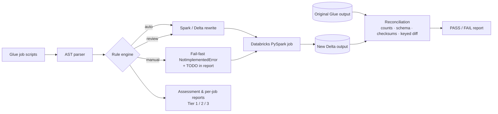

# glue2dbx: AWS Glue → Databricks migration toolkit

[](https://github.com/Prashanthhh14/glue-to-databricks-migrator/actions/workflows/ci.yml)


Moving hundreds of AWS Glue jobs to Databricks usually fails in the boring places: nobody knows which jobs are easy,
hand-rewrites drift from the original logic, and "it ran" gets mistaken for "it's correct".

**glue2dbx** turns that into a repeatable three-step process:

| Step | Command | What you get |
|---|---|---|
| 1. **Assess** | `glue2dbx assess jobs/` | Every job scanned and tiered by effort, with a wave plan |
| 2. **Convert** | `glue2dbx convert jobs/ --out converted/` | Databricks-ready PySpark + a report per job |
| 3. **Reconcile** | `glue2dbx reconcile --source … --target … --keys id` | Proof the new output matches the old, row by row |



## Quick start

```bash
git clone https://github.com/Prashanthhh14/glue-to-databricks-migrator.git
cd glue-to-databricks-migrator
pip install -e ".[spark,dev]"        # needs Java 17+ for the Spark parts

glue2dbx assess examples/glue_jobs
glue2dbx convert examples/glue_jobs --out examples/converted --catalog main
pytest -q                             # 34 tests, including a real Spark end-to-end run
```

## What it converts

| Glue construct | Becomes | Status |
|---|---|---|
| `GlueContext`, `SparkContext`, `Job.init/commit` | `SparkSession.builder.getOrCreate()` | auto |
| `getResolvedOptions(sys.argv, [...])` | `get_job_args([...])` (Databricks widgets, CLI fallback) | auto |
| `create_dynamic_frame.from_catalog` (+ `push_down_predicate`) | `spark.table("catalog.db.table").where(...)` | auto |
| `create_dynamic_frame.from_options` (S3 csv/json/parquet) | `spark.read.format(...).option(...).load(...)` | auto |
| `from_options` (JDBC / Postgres / MySQL …) | JDBC reader with credentials moved to `dbutils.secrets` | review |
| `ApplyMapping` | `select(F.col(src).cast(type).alias(tgt), ...)` | auto |
| `Filter` with a lambda | Spark Column expression (no Python UDF) | auto |
| `ResolveChoice` (`cast:` / `project:`) | `withColumn(cast)` | auto |
| `SelectFields`, `DropFields`, `RenameField`, `DropNullFields` | `select`, `drop`, `withColumnRenamed`, helper | auto |
| `Join` | `df.join(..., how="inner")` | review |
| `DynamicFrame.fromDF` / `.toDF()` | removed (DataFrames end to end) | auto |
| `write_dynamic_frame.from_options` / `from_catalog` | Delta `save(...)` / `saveAsTable(...)` | auto |
| `Relationalize`, `Map`, `Unbox`, `SplitFields`, Kinesis/Kafka sources … | left in place behind a `raise NotImplementedError` | manual |

**Example**: the Glue `Filter` lambda

```python
Filter.apply(frame=typed, f=lambda row: row["amount_usd"] > 0 and row["status"] in ["PLACED", "SHIPPED"])
```

becomes a JVM-native Spark filter:

```python
typed.filter((F.col("amount_usd") > 0) & F.col("status").isin(["PLACED", "SHIPPED"]))
```

See [`examples/glue_jobs`](examples/glue_jobs) (input) and [`examples/converted`](examples/converted) (output and reports).

## Results on the sample jobs

From [`examples/converted/reports/ASSESSMENT.md`](examples/converted/reports/ASSESSMENT.md):

| Job | Auto | Review | Manual | Tier |
|---|---|---|---|---|
| `orders_daily_load` | 10 | 0 | 0 | 1 - lift and shift |
| `positions_jdbc_extract` | 7 | 1 | 0 | 2 - convert and review |
| `trades_enrichment` | 9 | 1 | 0 | 2 - convert and review |
| `customer_events_flatten` | 6 | 0 | 2 | 3 - re-engineer |

**36 Glue constructs, 94% converted automatically.** The Tier 1 job is converted, executed on local Spark and
reconciled against an independently hand-written version in [`tests/test_end_to_end.py`](tests/test_end_to_end.py)
on every CI run.

## Reconciliation

```bash
glue2dbx reconcile \
  --source s3://old-lake/curated/orders/ --source-format parquet \
  --target main.curated.orders          --target-format table \
  --keys order_id --exclude loaded_at --report recon/orders.md
```

Checks, all done with Spark aggregates (nothing collected to the driver):

1. Row counts
2. Schema drift: missing, extra and re-typed columns
3. Per-column null counts and an **order-independent checksum** (sum of `xxhash64`), so a reshuffled table still matches
4. With `--keys`: rows missing from target, unexpected rows, and rows whose values changed (with sample keys)

Exit code is `1` on any mismatch, so it can gate a CI/CD release or a Databricks Job task.

## Design decisions

- **AST rewrite, not regex.** Parsing the script into a syntax tree means nested calls, keyword vs positional
  arguments and multi-line calls are handled correctly, and the output is always valid Python.
- **Fail fast instead of guessing.** Anything without a safe 1:1 rewrite is kept in place behind a
  `raise NotImplementedError`, so a half-migrated job can't run and quietly produce wrong data.
- **Three statuses, three tiers.** `auto / review / manual` per construct rolls up into a job tier, which is what
  you need to plan migration waves and staff them.
- **Same semantics where it matters.** S3 sinks keep Glue's append behaviour; `ApplyMapping` keeps only mapped
  columns; `DropNullFields` drops only all-null columns.
- **Correctness is proven, not assumed.** Reconciliation is part of the toolkit, not an afterthought.

## Project layout

```
src/glue2dbx/
  converter.py   AST transformer and rule set
  reconcile.py   Spark reconciliation engine
  report.py      Markdown / CSV assessment output
  cli.py         assess | convert | reconcile
examples/
  glue_jobs/     four realistic Glue jobs (one per tier, plus JDBC)
  converted/     generated Databricks jobs and reports
  sample_data/   CSV input for the end-to-end test
tests/           unit tests + Spark reconciliation + end-to-end
```

## Roadmap

- Job bookmark → Auto Loader / watermark rewrite
- Glue workflow & trigger → Databricks Workflows YAML
- Unity Catalog grants generated from Lake Formation permissions

## License

MIT © Prashanth Kumar
